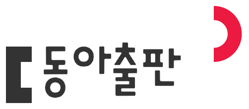
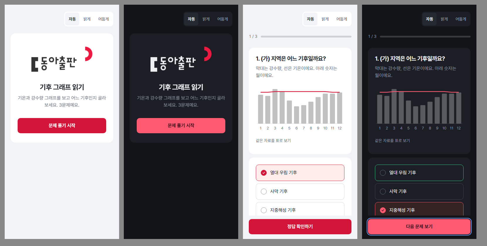
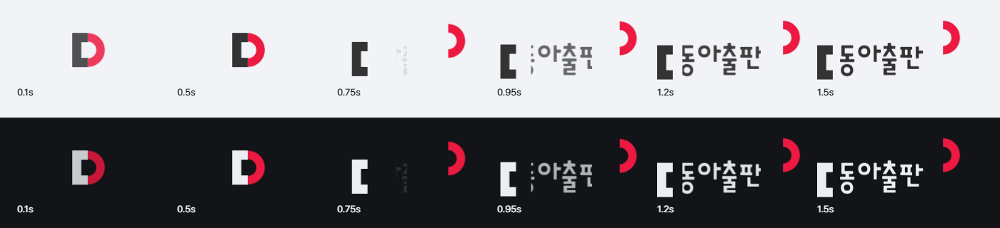
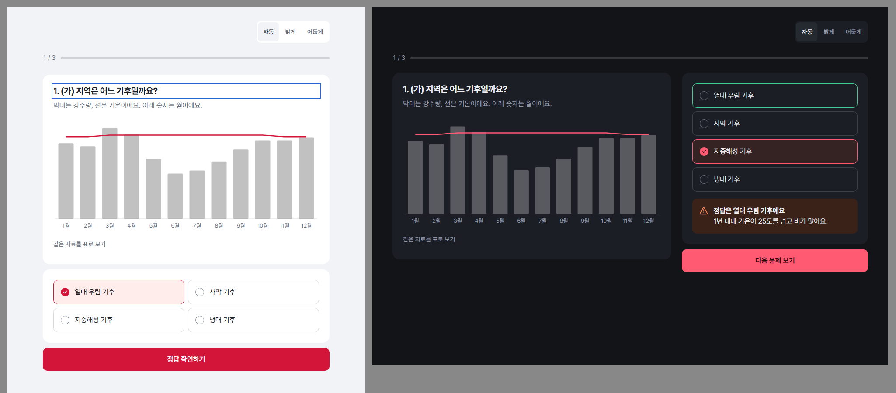

<p align="center"></p>

# 동아 디자인 (donga-design)

Claude Code나 Codex가 동아출판 자료의 화면을 만들 때 쓰는 프론트엔드 디자인 스킬입니다. [당토 디자인(dangto-design)](https://github.com/yhk1m/dangto-design)의 디자인 규격을 그대로 따르고, 색은 동아출판 CI로 고정했습니다.

당토 디자인처럼 꾸밈을 더하기보다 덜어내는 쪽입니다. 화면마다 할 일 하나를 분명히 하고, 정보의 순서와 크기로 완성도를 냅니다. 여기에 동아출판 CI 색과 로고, 그리고 동아출판 제작 가이드의 구조와 보안 규칙을 더했습니다.



위 그림은 학생용 기후 그래프 퀴즈에 이 스킬을 적용한 예시입니다. 왼쪽부터 시작 화면(라이트, 다크), 문제 고르기, 정답 확인(다크) 화면입니다.

## 주요 내용

**CI 색 고정.** 동아출판 CI 그림에서 잰 빨강(`#ec1940`)과 먹(`#333333`)으로 색을 정했습니다. CI 빨강은 흰 글자를 얹으면 대비가 조금 모자라서, 버튼에 쓰는 주색은 밝기만 살짝 내린 `#d4153a`입니다. 다크 모드에서는 밝은 빨강 `#ff5a72` 위에 어두운 글자를 씁니다. 주색이 빨강이라 오류와 헷갈리지 않도록 위험색은 주황 쪽으로 옮기고, 오류는 늘 아이콘과 문구를 함께 보여 줍니다.

**라이트와 다크 모드.** 시스템 설정을 따르고, 화면 안에서 자동, 밝게, 어둡게를 고를 수 있습니다. 로고도 다크 모드에서 밝은 회색으로 바뀝니다.

**CI 열림 로고.** CI의 ㄷ과 ㅇ은 높이가 같아서, 맞닿으면 D 하나가 됩니다. 시작 화면에서 이 D가 양끝으로 벌어지며 그 사이에서 "동아출판"이 열립니다. 화면마다 한 번, 1.5초 안에 끝나고, 움직임 줄이기 설정이면 제자리에서 나타나기만 합니다.



**태블릿 레이아웃.** 동아출판 자료는 교실에서 학생 태블릿으로 가장 많이 엽니다. 그래서 휴대폰, 태블릿 세로, 태블릿 가로를 따로 설계합니다. 세로 태블릿은 넓은 한 칸에 선택지 2열, 가로 태블릿은 왼쪽에 그림이나 시뮬레이션을 고정하고 오른쪽에서 문제를 푸는 두 칸입니다. 터치 영역은 48px로 올리고, 방향을 바꿔도 푼 상태가 남고, 그래프는 화면 폭에 맞춰 다시 그려 글자가 커지지 않습니다.



**구조와 보안 규칙.** 동아출판 프론트엔드 제작 가이드에서 디자인은 빼고 내용 규칙만 가져왔습니다.

- CSS와 JS를 모두 담은 `index.html` 한 파일, 이미지와 글꼴만 `assets/` 폴더
- 모든 화면과 스타일은 `.dc-content` 래퍼 안에서만, 태그 선택자와 `!important` 없음
- `innerHTML`, `eval`, `fetch`, 외부 CDN, 이벤트 속성, `position: fixed` 없음
- 키보드로 모든 조작, 44px 터치 영역, 그래프에는 표 대안, 200% 확대
- 학생 개인정보는 모으지도 저장하지도 않음

그 밖에 당토 디자인의 원칙 6개, 화면 패턴, 해요체 문구 규칙, AI 티 나는 습관 목록, 완성 전 점검표가 모두 들어 있습니다.

## 설치

### Claude Code

```
/plugin marketplace add yhk1m/donga-design
/plugin install donga-design@donga-design
```

새 버전은 `/plugin marketplace update donga-design`을 입력한 뒤 `/plugin update donga-design@donga-design`으로 받습니다.

### Codex

```
codex plugin marketplace add yhk1m/donga-design
codex plugin add donga-design@donga-design
```

### 폴더를 직접 복사하기

이 저장소의 `skills/donga-design` 폴더를 통째로 복사해도 됩니다.

| 도구 | 모든 프로젝트에서 쓰기 | 한 프로젝트에서만 쓰기 |
|---|---|---|
| Claude Code | `~/.claude/skills/donga-design` | `프로젝트/.claude/skills/donga-design` |
| Codex | `~/.agents/skills/donga-design` | `프로젝트/.agents/skills/donga-design` |

## 사용법

요청 앞에 스킬 이름을 붙이면 확실하게 씁니다. Claude Code는 `/donga-design`, Codex는 `$donga-design`입니다.

```
/donga-design 위도별 태양 고도 시뮬레이션 만들어 줘
/donga-design 단원 마무리 퀴즈 10문제, 교실 화면용
/donga-design 교사용 채점 관리 화면, 촘촘하게
/donga-design 이 프로그램에 동아 디자인 적용해 줘
```

두클래스에 올리지 않는 독립 웹앱(React, 서버가 있는 앱)을 만들 때는 요청에 그렇게 적어 주세요. 실행 방식만 그에 맞추고, 보안과 접근성 규칙은 그대로 지킵니다.

## 점검 스크립트

화면을 만든 뒤 두 가지를 돌립니다. Node 18 이상이 필요하고, 화면 점검에는 Chrome도 필요합니다.

```
node skills/donga-design/scripts/rules-check.mjs 제출폴더
node skills/donga-design/scripts/check.mjs 제출폴더/index.html
```

`rules-check.mjs`는 단일 파일 구조, 래퍼 밖 선택자, 금지된 코드, 외부 자원, 확대 막기, 대체 글 빠짐 같은 규칙 위반을 찾습니다. `check.mjs`는 라이트와 다크, 휴대폰(390), 태블릿 세로(820), 태블릿 가로(1180) 폭에서 글자 대비, 작은 글자, 이모지, 터치 영역, 가로 넘침을 찾습니다. 둘 다 문제가 있으면 끝 코드 1로 끝납니다.

이 점검은 동아출판의 HTML 콘텐츠 검사기를 대신하지 못합니다. 두클래스에 올리기 전에는 담당자 검사기도 꼭 거쳐 주세요.

## 파일 구성

```
skills/donga-design/
  SKILL.md                   시작 절차, 원칙, 핵심 규칙, 금지 목록, 점검표
  references/brand.md        CI 색, 로고, 열림 애니메이션
  references/douclass.md     구조, 보안, 저장, 접근성, 제출 점검
  references/tablet.md       태블릿 세로, 가로 배치와 터치
  references/tokens.md       글자, 간격, 모서리, 그림자, 움직임 값 (당토)
  references/patterns.md     화면 패턴 (당토)
  references/writing.md      화면 문구 규칙 (당토)
  references/components.md   TDS, SEED 문서를 보고 부품 짜기 (당토)
  references/fonts.md        서체 (당토)
  references/sources.md      당토 규칙의 근거
  assets/tokens.css          .dc-content 래퍼용 CSS, CI 색 고정
  assets/fonts/              Pretendard 4종과 라이선스
  assets/logo/               CI SVG(라이트, 다크), 열림 로고 조각, 시간별 그림
  assets/examples/           적용 예시 코드와 그림
  scripts/rules-check.mjs    구조, 보안 자동 점검
  scripts/check.mjs          화면 자동 점검
```

## 라이선스

스킬의 글과 코드는 [MIT 라이선스](LICENSE)입니다.

**동아출판 CI(로고, 이름, 색)는 MIT 라이선스에 들어가지 않습니다.** CI는 동아출판의 것이며, 로고 SVG는 제공받은 CI 그림을 따라 그린 것입니다. 동아출판 자료를 만들 때만 쓰고, 회사가 준 원본 로고 파일이 있으면 그것을 먼저 쓰세요. 공식 로고와 저작권 문구의 최종 사용은 동아출판 담당자가 정합니다.

이 스킬은 동아출판의 공식 디자인 시스템이 아닙니다.

- Pretendard: Copyright (c) 2021 Kil Hyung-jin, SIL Open Font License 1.1. 파일과 라이선스 전문을 `assets/fonts/`에 함께 넣었습니다.

## 만든 사람

양정고등학교 지리교사 김용현  
문의: bgnlkim@gmail.com
